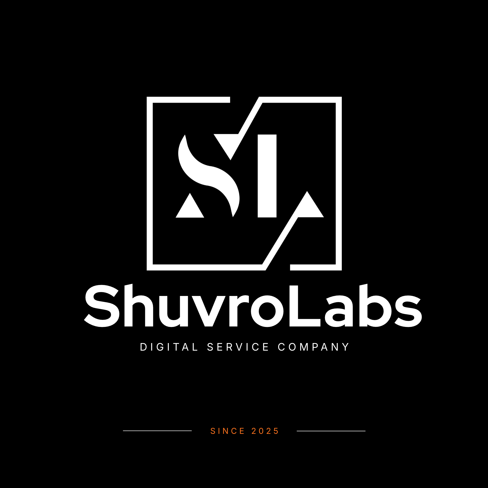

<div align="center">
  <a href="https://github.com/your-hossain-bhai/ShuvroLabs">
    
  </a>

  <h1>SHUVROLABS</h1>
  <h3>Your Vision. Our Creation.</h3>
  <p><strong>One creative technology partner. Everything digital, under one roof.</strong></p>
  <p>
    We help founders, startups, and growing brands <strong>design better, build smarter, and grow further</strong>
    through technology, creativity, and strategic execution.
  </p>

  <p>
    <a href="#-what-we-do"></a>
    <a href="#-selected-work"></a>
    <a href="mailto:muhammadhossain.27.2001@gmail.com"></a>
  </p>

  <p><sub>EST. 2025 &nbsp;·&nbsp; CHATTOGRAM, BANGLADESH &nbsp;·&nbsp; OPEN TO GLOBAL COLLABORATION</sub></p>
</div>

---

## ✦ Who We Are

**ShuvroLabs** is an independent digital service company founded in **2025** by **Muhammad Hossain**. We bring software engineering, brand experiences, creative production, and growth strategy together so ambitious ideas don't get lost between multiple agencies and disconnected tools.

**Our belief is simple:** good ideas deserve extraordinary execution. Whether you need your first website, a custom app, a smarter workflow, or a stronger digital presence, we focus on building solutions around your business goals—not just delivering files.

> **From the first idea to the next big milestone—we turn possibilities into products and digital experiences.**

## ⚡ What We Do

| Build & Engineer | Brand & Create | Market & Grow |
|:--|:--|:--|
| **Web Design & Development** — Landing pages, business websites, responsive web experiences | **Brand Identity & UI/UX** — Visual identity, interfaces, design systems | **SEO & Search Visibility** — Technical SEO, on-page optimization, local search |
| **Mobile App Development** — Flutter and mobile-first product experiences | **Video Editing & Content** — Branded videos, motion-led content, short-form creative | **Digital Marketing** — Campaign planning, social presence, performance-oriented strategy |
| **Custom Software & AI** — Business tools, integrations, intelligent workflows | **Creative Direction** — Digital storytelling and cohesive brand experiences | **Lead Generation & Outreach** — Prospect research, outreach workflows, sales pipeline support |

**Also:** Marketing & growth consultancy, product discovery, and automation strategy.

**Not sure where to start?** [Tell us what you're building →](mailto:muhammadhossain.27.2001@gmail.com?subject=Project%20Inquiry%20%E2%80%94%20ShuvroLabs)

## ✳ Why ShuvroLabs?

- **One connected partner:** Design, development, content, and growth can work together instead of competing for attention.
- **Built around the problem:** We start by understanding the audience, business requirements, and desired outcome.
- **Technology with purpose:** Practical solutions, maintainable architecture, and thoughtful user experiences.
- **A founder-led approach:** Direct communication, transparency, and ownership of the work.
- **Think local. Build global:** Based in Bangladesh and open to collaborations worldwide.

## 🚀 Selected Work

The projects below come from our **founder's public development portfolio** and demonstrate the types of work and technologies behind ShuvroLabs. **They are not represented as commissioned or paid client projects.**

| Project | What It Demonstrates | Explore |
|:--|:--|:--|
| **Heaven Furniture Mart** | Premium, conversion-focused website experience for a furniture/interior brand | [View project ↗](https://github.com/your-hossain-bhai/heaven-furniture-mart) |
| **KrishokDhoni / Project Ashtha** | Flutter-based, Bengali voice-first agricultural assistance | [View project ↗](https://github.com/your-hossain-bhai/Project-Ashtha) |
| **PrepMate BD** | AI-assisted learning and exam-preparation platform | [View project ↗](https://github.com/your-hossain-bhai/PrepMate-BD) |
| **Employee Tracking** | Mobile workforce management, attendance, and geolocation workflows | [View project ↗](https://github.com/your-hossain-bhai/EmployeeTracking) |
| **Revenue Leak Finder** | Lead analytics, business workflow automation, and revenue-opportunity insights | [View project ↗](https://github.com/your-hossain-bhai/revenue-leak-finder) |
| **BizPilot AI** | AI-oriented tools and interfaces for growing businesses | [View project ↗](https://github.com/your-hossain-bhai/bizpilot-ai-bangladesh) |

**[Explore more from our founder on GitHub ↗](https://github.com/your-hossain-bhai?tab=repositories)**

## 🧭 How We Work

```text
01  DISCOVER      → Understand your vision, audience, and challenges
02  STRATEGIZE    → Define the scope, design direction, and roadmap
03  CREATE        → Design, develop, review, and refine
04  LAUNCH & GROW → Ship confidently and plan the next improvement
```

We value **clear communication, thoughtful execution, and long-term usefulness** over complexity for its own sake.

---

## 💻 About This Website

This repository contains the official **ShuvroLabs agency landing page**—a lightweight, responsive website built to communicate our services, show selected work, introduce the founder, and help potential collaborators get in touch.

### Website Highlights

- Original ShuvroLabs visual identity: **near-black, warm white, and signature orange**
- Bold, editorial hero with the line **“Your Vision. Our Creation.”**
- Responsive navigation and layouts for mobile, tablet, and desktop
- **Nine service offerings** with project-inquiry shortcuts
- **Six founder-portfolio showcases** with working category filters
- Studio story, founder introduction, process, FAQ, and complete footer
- Accessible navigation touches, scroll-reveal effects, and reduced-motion support
- A project inquiry form that **prepares an email in the visitor's email app**

### Built With


**Frontend:** Vanilla HTML, CSS, and JavaScript · **Typography:** Manrope and DM Sans · **Hosting:** Any static host

No framework build step, database, or application server is required.

### Repository Structure

```text
ShuvroLabs/
├── README.md                     # This project overview
└── shuvrolabs-site/
    ├── index.html                # Main page
    ├── style.css                 # Layouts, branding, responsive styles
    ├── script.js                 # Interactions and inquiry form
    ├── README.md                 # Website-specific setup notes
    └── assets/
        ├── favicon.png
        ├── shuvrolabs-logo.png
        ├── shuvrolabs-mark.png
        └── shuvrolabs-original.png
```

### Run Locally

```bash
git clone https://github.com/your-hossain-bhai/ShuvroLabs.git
cd ShuvroLabs/shuvrolabs-site
python -m http.server 8000
```

Open **http://localhost:8000** in your browser. You can also open `shuvrolabs-site/index.html` directly without installing dependencies. On Windows, `py -m http.server 8000` is an alternative if `python` isn't available.

### Deploy

**Netlify / Cloudflare Pages:** Deploy this repository as a static site and set the publish/output directory to **`shuvrolabs-site`**. No build command is needed.

**GitHub Pages:** Branch-based publishing supports the repository root or `/docs`, **not an arbitrary `shuvrolabs-site` folder**. To publish using **Settings → Pages → Deploy from a branch**, first move `index.html`, `style.css`, `script.js`, and `assets/` together into the repository root (or into `/docs`) and select that directory in Pages settings. Alternatively, configure a custom GitHub Actions Pages workflow to upload `shuvrolabs-site` as the site artifact.

> **Before production:** The contact form uses `mailto:` and doesn't submit to a server or save messages. Connect a proper form backend for reliable inquiry collection. Replace the interim contact email with an official business address, and add real case studies or testimonials only when you have permission to publish them.

---

## 👤 Founder & CEO

### Muhammad Hossain

**Software Developer · AI/ML Builder · Digital Entrepreneur**

Muhammad founded ShuvroLabs to bring **technology, creativity, and practical business growth** together. His interests span full-stack engineering, Flutter applications, AI-enabled software, product design, and solving real-world problems through digital innovation.

[](https://www.linkedin.com/in/muhammadhossain27/)
[](https://github.com/your-hossain-bhai)

## 🤝 Let's Build Something Remarkable

**Launching a business? Growing a brand? Have a product idea that deserves to exist?**

Let's make your next move count.

**Email:** [muhammadhossain.27.2001@gmail.com](mailto:muhammadhossain.27.2001@gmail.com?subject=Let%27s%20Build%20%E2%80%94%20ShuvroLabs)  
**Based in:** Chattogram, Bangladesh · **Available for:** Remote and international collaborations  
**LinkedIn:** [Connect with our founder](https://www.linkedin.com/in/muhammadhossain27/)

<div align="center">

---

### YOUR VISION. **OUR CREATION.**

<sub>ShuvroLabs · Digital Service Company · Since 2025</sub>

<sub>© 2026 ShuvroLabs. All rights reserved.</sub>

</div>
